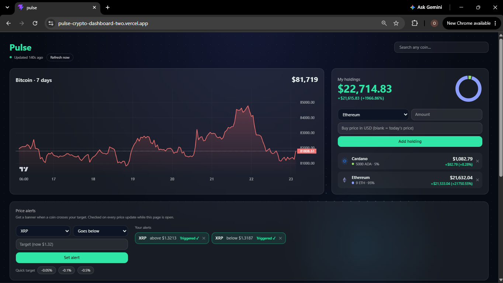

# Pulse

A live crypto dashboard built with React, TypeScript and Tailwind. Track prices, view 7-day charts, manage a demo portfolio with profit and loss, and set price alerts.

**Live demo:** https://pulse-crypto-dashboard-two.vercel.app



## Features

- **Live prices** for a default watchlist, refreshed every 30 seconds, with a card that flashes green or red when a price moves
- **7-day price chart** that redraws when you select a coin
- **Coin search**: find a coin by name and add it to your watchlist (up to 6 extra)
- **Holdings tracker** with a total that animates as prices change
- **Profit and loss**: enter a buy price per holding and see the gain or loss per coin and for the whole portfolio
- **Allocation ring** showing each coin's share of the portfolio
- **Price alerts**: set a target above or below a coin's price and get a banner when it is crossed
- **Sort and filter** the coin cards by price, 24h change or name, and show only gainers or losers
- **Interactive background** that responds to the cursor

## Tech stack

- [React](https://react.dev) and TypeScript, built with [Vite](https://vite.dev)
- [Tailwind CSS](https://tailwindcss.com) v4
- [TanStack Query](https://tanstack.com/query) for data fetching and caching
- [Framer Motion](https://www.framer.com/motion/) for animations
- [Lightweight Charts](https://tradingview.github.io/lightweight-charts/) for price charts
- [CoinGecko API](https://www.coingecko.com/en/api) for market data
- Deployed on [Vercel](https://vercel.com)

## Getting started

```bash
git clone https://github.com/opiper21/pulse-crypto-dashboard.git
cd pulse-crypto-dashboard
npm install
npm run dev
```

Then open the local address that Vite prints (usually `http://localhost:5173`).

To create a production build:

```bash
npm run build
```

## How it works

- Prices, search results and charts come from the free CoinGecko API. Responses are cached in the browser, and the app falls back to the last saved prices if a request fails or is rate limited.
- Search input is debounced so typing does not flood the API.
- Holdings, extra watchlist coins and alerts are saved in the browser's `localStorage`. There is no backend and no account, so each visitor only sees their own data.
- Price alerts are checked on every price update while the page is open. They are not push notifications.
- A "Simulate +/-0.3%" control nudges the displayed prices so alerts can be tested without waiting for the market. A "Simulated prices" badge shows while it is active, and Reset returns to real prices.

## Notes

- This is a demo project and is not financial advice. Holdings are example data, not a real account.
- The free CoinGecko tier is rate limited. If you see "Couldn't refresh", wait a minute and try again.

## Author

Built by Sodiq Olabode (PiperX), a full-stack web developer based in Lagos, open to remote work.

- Portfolio: https://portfolio-olabode.vercel.app
- GitHub: https://github.com/opiper21